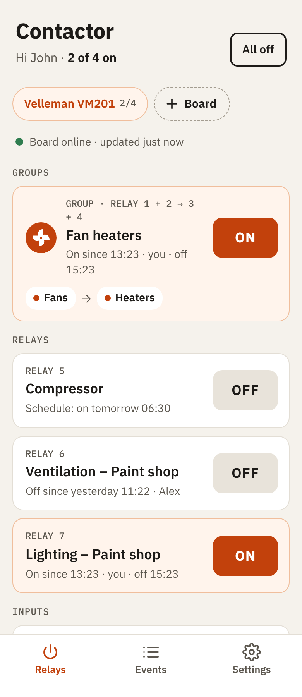
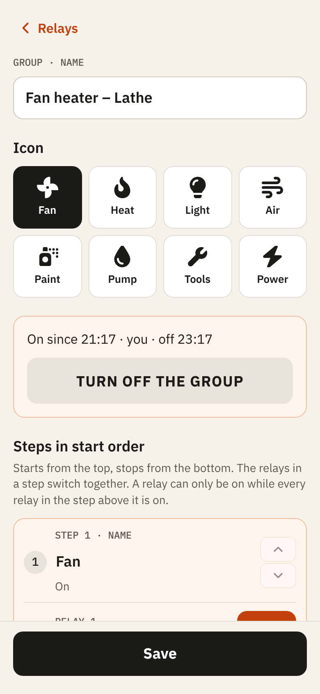
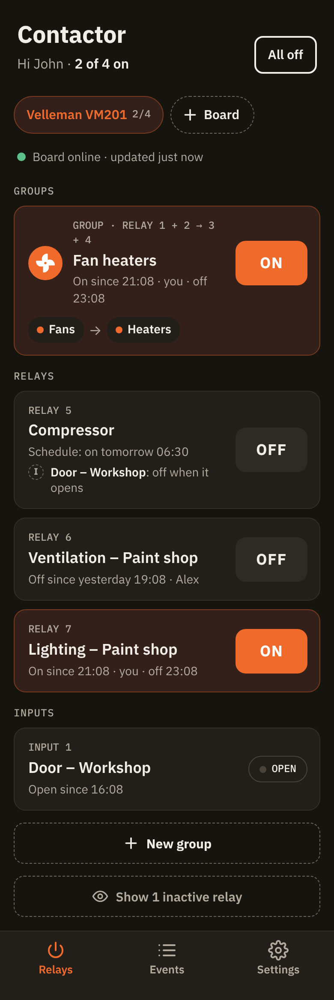
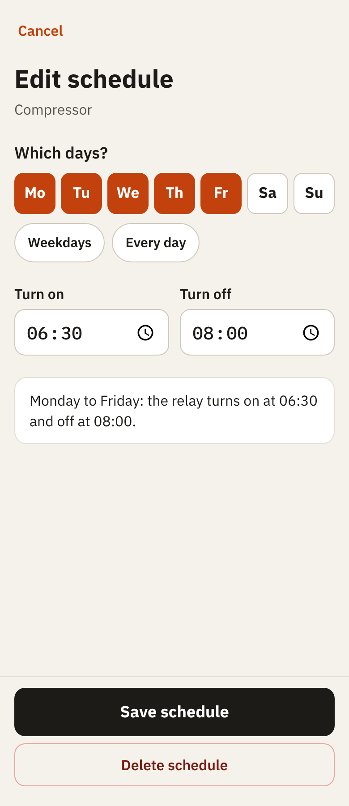
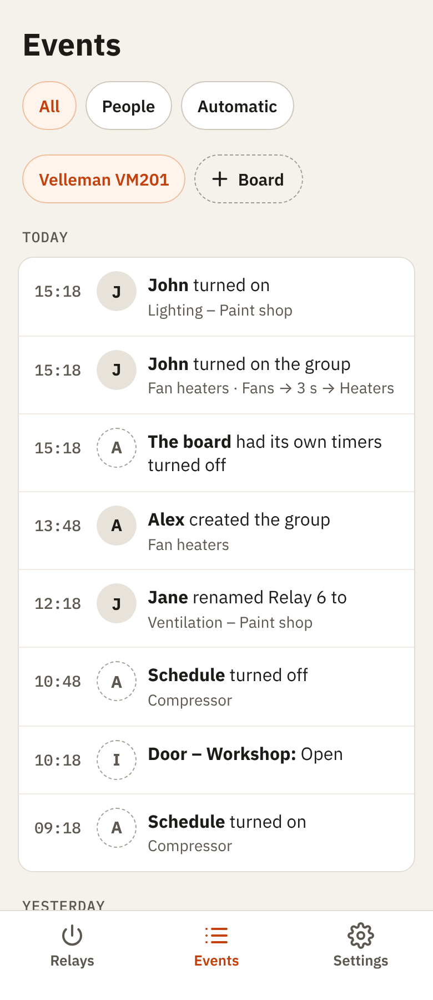
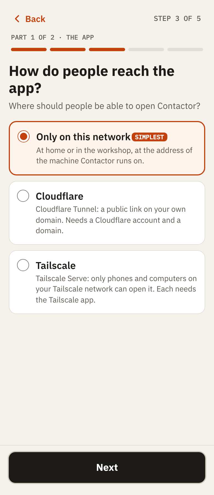
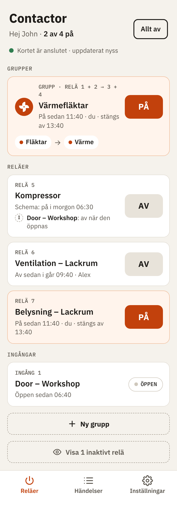
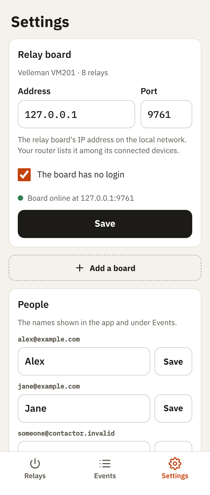
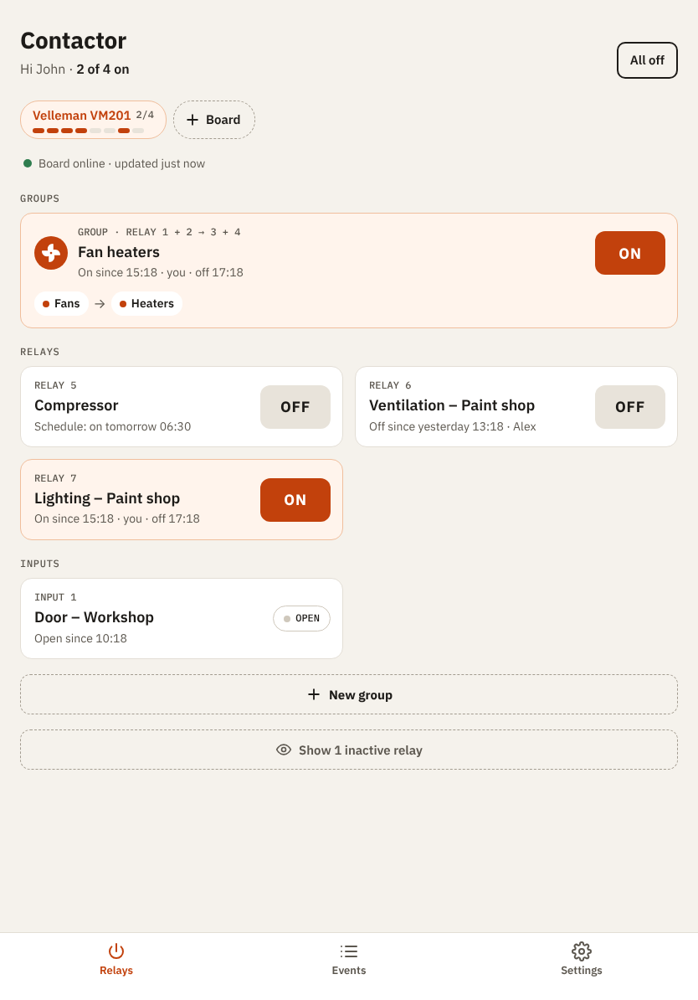

# Contactor

Contactor switches the relays on a relay board from your phone. It is made for a workshop and for people who aren't
technical: big buttons, plain words and few menus.

A day in the workshop:

- A schedule runs the compressor from 06:30 to 08:00.
- One tap starts the fan heaters. The fans start first, then the heat. Another tap turns the heat off at once, and the
  fans run on for a few minutes before they stop.
- A light someone forgot goes off by itself after 2 hours.
- The event log shows who did what, and when.

It works like an app on a phone and uses the whole screen on a tablet or a computer, in light and dark mode, in
English or Swedish.

<p>
  
  
  
</p>

## What it does

- **Setup guide:** a few short questions: the language, how people reach the app and sign in, your name, which relay
  board, where it is, and what each relay switches, with "Try" to hear which one it is.
- **Relays:** one big ON/OFF button per relay, with who turned it on and when it goes off. "All off" turns everything
  off.
- **Auto-off:** a relay that someone turns on goes off by itself after 1, 2 or 4 hours, or never, as set for that
  relay.
- **Schedules:** on and off at set times on chosen days, also over midnight and across daylight saving changes.
- **Groups in steps:** a group starts from the top, step by step, and stops from the bottom, with a wait and a run-on
  time. A step can hold several relays, e.g. two fans, then two heaters. A short guide creates a group, and a group can
  have schedules too.
- **Interlock:** a relay in a group may only be on while every relay in the steps above it is on. Whatever breaks that
  order, e.g. a fan stopped with a button on the board itself, the app turns the relays below off at once: here both
  heaters.
- **Event log:** every change, by a person, a schedule, auto-off or at the board itself.
- **Backups and updates:** a copy of the database every night, a download button, and "Update now" in Settings.

<p>
  
  
  
</p>

<p>
  
  
  
</p>

On a tablet the cards sit in two columns. On a computer a side menu replaces the tab bar:

<p>
  
  
</p>

**Safety:** the interlock in the app is an extra layer, not a safety device. It only works while the app runs. Where
safety depends on it, e.g. heat without the fan, wire it in the installation as well. Electrical work must be done by
a qualified electrician.

## Supported boards

| Board | Relays | Status |
|---|---|---|
| Velleman VM201 (WMRC201), ethernet | 8, plus 1 input | Supported. See [its README](Contactor.Boards.Velleman/README.md) |
| Velleman VM204 (WMRC204), ethernet | 4, plus 4 inputs and 1 analog input | In the app and the simulator. Not yet tested on a real board. See [its README](Contactor.Boards.Velleman/README.md) |
| Velleman VM208, ethernet or WLAN | 4, plus 1 input | In the app and the simulator. Not yet tested on a real board. See [its README](Contactor.Boards.Velleman/README.md) |
| Waveshare Modbus PoE ETH Relay, (B), (C), 16CH and 30CH | 8, 8 plus 8 inputs, 8 plus 8 inputs, 16, 30 | In the app and the simulator. Not yet tested on a real board. See [its README](Contactor.Boards.Waveshare/README.md) |
| Denkovi smartDEN IP-16R-MT, Modbus TCP | 16 | In the app and the simulator. Not yet tested on a real board. See [its README](Contactor.Boards.Denkovi/README.md) |
| Denkovi DAEnetIP2 v2 with a 16-, 8- or 2-relay board, SNMPv1 | 16, 8, 2, each plus 8 analog inputs | In the app and the simulator. Not yet tested on a real board (Issue #371). See [its README](Contactor.Boards.Denkovi/README.md#daenetip2-v2) |
| Devantech ETH002-B, ETH008-B, ETH1610, ETH484-B and ETH8020-B | 2, 8, 10 plus 16 analog inputs, 4 plus 8 inputs and 4 analog inputs, 20 plus 8 inputs and 8 analog inputs | In the app and the simulator. Not yet tested on a real board. See [its README](Contactor.Boards.Devantech/README.md) |
| Advantech ADAM-6060, ADAM-6066 and ADAM-6260, Modbus TCP | 6 plus 6 inputs, 6 plus 6 inputs, 6 | In the app and the simulator. Not yet tested on a real board. See [its README](Contactor.Boards.Advantech/README.md) |

One installation can run several boards, of any of these models: the setup guide sets up the first, and Settings →
"Add a board" adds more. Each manufacturer has a small project behind one interface, `IRelayBoard`, so a new board needs its own project and
nothing else in the app.

## How it runs

- On a Raspberry Pi, or another Linux machine with Docker, on your own network next to the board, with Docker Compose.
- No port is opened to the internet. People reach the app "Only on this network" (the simplest), or through
  Cloudflare or Tailscale, chosen in the setup guide.
- Every request goes through the sign-in that fits: Cloudflare Access (e.g. a one-time code by e-mail), Tailscale's
  login, or no sign-in, only on your own network. Without a sign-in the event log can't tell people apart.
- .NET 10, Blazor Server and SQLite. No JavaScript framework.

## Install

On a machine on your own network, e.g. a Raspberry Pi with Raspberry Pi OS (64-bit), or another Linux machine with
Ubuntu or Debian (not a rented cloud server), run this as your normal user:

```sh
curl -fsSL https://github.com/gonace/Contactor/releases/latest/download/install.sh | sh
```

It asks nothing. It installs Docker if it isn't installed, puts Contactor in `/opt/contactor` and starts it. It uses
sudo for that, so it can ask for your password. At the end it shows the address to open and the setup code. Type the
code on that page, and the setup guide does the rest. Run the command again to see them again. It changes nothing that
works.

To update Contactor later, press "Update now" in its Settings. If the new version doesn't start, it goes back to the
old one by itself.

Port 8080 is for your own network only: never forward it from the router. To reach the app from outside, choose
Cloudflare or Tailscale in the setup guide.

To remove Contactor, add `--uninstall`: `... | sh -s -- --uninstall`. Your data stays in `/opt/contactor/data`, and
installing again takes it back. `--uninstall --delete-data` deletes that too.

## Development

Needs the .NET 10 SDK.

```sh
dotnet build
dotnet test
```

Run everything locally with Aspire, which also needs Docker Desktop (once: `dotnet tool install -g Aspire.Cli --version
13.5.4`):

```sh
aspire run
```

The dashboard links to everything it starts:
- **The app** on http://localhost:8080, built from the `Dockerfile` as on a real installation. Its data is in the
  Docker volume `contactor-dev`. Delete the volume to start over. A new database starts with the setup guide, behind
  the setup code in the app's log.
- **The simulator**, a VM201 the app talks to, with a page to switch its relays and see its traffic. Stop and start
  it in the dashboard to test a lost connection to the board. No hardware is needed, and the tests use it too.
- **The demo** on http://localhost:5070, as on [the public demo](https://contactor.obscured.app). How to host it is in
  [`docs/DEMO.md`](docs/DEMO.md).

The screenshots above are taken by `node scripts/screenshots/take.mjs`, with made-up data. `docs/ARCHITECTURE.md`
tells how the app is built, and `AGENTS.md` how to work in this repository.

## Licence

Contactor is released under the MIT License, see `LICENSE`. It also includes others' work under their own licences:
the fonts, the group icons, the packages it uses and, in the image, `cloudflared` and Tailscale.
`THIRD-PARTY-NOTICES.md` lists them.
