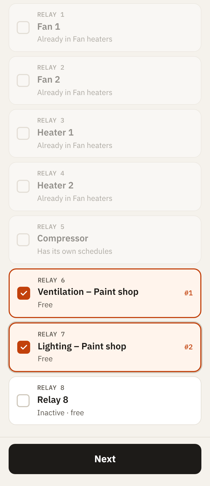
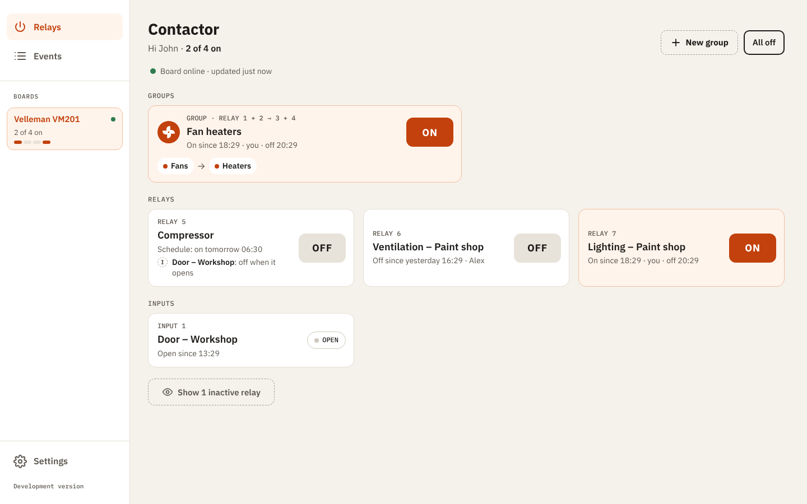

# Contactor

Control a relay board from your phone: turn things on and off, run them on schedules, and start several relays in
order as one group, e.g. a fan heater: the fan first, then the heat, and the fan running on after the heat goes off.
An interlock keeps the group in that order whatever happens, and every change is logged with who made it.

It is built for a workshop and for people who aren't technical: big buttons, few menus, and a page that works like an
app on the phone and uses the whole screen on a tablet or a computer, in light and dark mode.

<p>
  
  
  
</p>

## What it does

- **Setup guide:** a new installation starts with a few short questions: your name, which relay board, where it is
  on the network, and what each relay switches, with "Try" to hear which one it is.
- **Relays:** one big on/off button per relay, with who turned it on and when it goes off. "All off" turns
  everything off.
- **Auto-off:** a relay someone turns on goes off by itself after 1, 2 or 4 hours, unless set to never.
- **Schedules:** on and off at set times on chosen days, also over midnight and across daylight saving changes.
- **Groups:** two or more relays that start from the top and stop from the bottom, with a wait between steps and a
  run-on time, created with a short guide.
- **Interlock:** a relay in a group may only be on while the ones above it are; if something breaks the order, e.g.
  someone presses a button on the board itself, the app turns the relays below off at once.
- **Event log:** every change, by a person, a schedule, auto-off or at the board itself.
- **Backups:** a copy of the database every night, and a download button.

<p>
  
  
  
</p>

On a tablet the cards sit in two columns; on a computer a side menu replaces the tab bar:

<p>
  
  
</p>

The interlock in the app is an extra layer, not a safety device: it only works while the app runs. Where safety
depends on it, e.g. heat without the fan, wire it in the installation as well. Electrical work must be done by a
qualified electrician.

## Supported boards

| Board | Relays | Status |
|---|---|---|
| Velleman VM201 (WMRC201), ethernet | 8, plus 1 input | Supported. See [its README](Contactor.Boards.Velleman/README.md) |
| Velleman VM204 (WMRC204), ethernet | 4, plus 4 inputs and 1 analog input | In the app and the simulator; not yet tested on a real board, and `deploy/` sets up a VM201 only. See [its README](Contactor.Boards.Velleman/README.md) |
| Velleman VM208, ethernet or WLAN | 4, plus 1 input | In the app and the simulator; not yet tested on a real board, and `deploy/` sets up a VM201 only. See [its README](Contactor.Boards.Velleman/README.md) |
| Waveshare Modbus PoE ETH Relay, (B), (C), 16CH and 30CH | 8, 8 plus 8 inputs, 8 plus 8 inputs, 16, 30 | In the app and the simulator; not yet tested on a real board, and `deploy/` sets up a VM201 only. See [its README](Contactor.Boards.Waveshare/README.md) |
| Denkovi smartDEN IP-16R-MT, Modbus TCP | 16 | In the app and the simulator; not yet tested on a real board, and `deploy/` sets up a VM201 only. See [its README](Contactor.Boards.Denkovi/README.md) |
| Denkovi DAEnetIP2 v2 with a 16-, 8- or 2-relay board, SNMPv1 | 16, 8, 2 | In the app and the simulator; not yet tested on a real board (Issue #371), and `deploy/` sets up a VM201 only. See [its README](Contactor.Boards.Denkovi/README.md#the-daenetip2-v2) |
| Devantech ETH002-B, ETH008-B, ETH484-B and ETH8020-B | 2, 8, 4 plus 8 inputs, 20 plus 8 inputs | In the app and the simulator; not yet tested on a real board, and `deploy/` sets up a VM201 only. See [its README](Contactor.Boards.Devantech/README.md) |
| Advantech ADAM-6060, ADAM-6066 and ADAM-6260, Modbus TCP | 6 plus 6 inputs, 6 plus 6 inputs, 6 | In the app and the simulator; not yet tested on a real board, and `deploy/` sets up a VM201 only. See [its README](Contactor.Boards.Advantech/README.md) |

The app talks to a board through one interface, `IRelayBoard`, so another board needs its own small project and
nothing else. One installation can run several boards, of any of these models: the setup guide sets up the first, and
Settings → "Add a board" adds more.

## How it runs

- On a Raspberry Pi (or another Linux machine with Docker) on your own network, next to the board, with Docker Compose.
- Every request goes through the sign-in chosen in the setup guide, e.g. Cloudflare Access with a one-time code by
  e-mail; no port is opened to the internet.
- .NET 10, Blazor Server and SQLite. No JavaScript framework.

## Install

On a machine on your own network, e.g. a Raspberry Pi with Raspberry Pi OS (64-bit), or another Linux machine with
Ubuntu or Debian (not a rented cloud server), run this as your normal user:

```sh
curl -fsSL https://github.com/gonace/Contactor/releases/latest/download/install.sh | sh
```

It asks nothing. It installs Docker if it isn't installed, puts Contactor in `/opt/contactor` and starts it. It uses
sudo for that, so it can ask for your password. At the end it shows the address to open and the setup code: type the
code on that page, and the setup guide does the rest. Run the command again to see them again. It changes nothing that
works. To update Contactor later, press "Update now" in its Settings: it goes back by itself if the new version doesn't
start.

Port 8080 is for your own network only: never forward it from the router. From outside, people come in through
Cloudflare or Tailscale, which you choose in the setup guide.

To remove Contactor, add `--uninstall`: `... | sh -s -- --uninstall`. Your data stays in `/opt/contactor/data`, and
installing again takes it back. `--uninstall --delete-data` deletes that too.

## Development

Needs the .NET 10 SDK.

```sh
dotnet build
dotnet test
```

Run everything locally with Aspire, which also needs Docker Desktop (once: `dotnet tool install -g Aspire.Cli --version
13.5.4`):

```sh
aspire run
```

The dashboard links to everything it starts:
- **The app** on http://localhost:8080, built from the `Dockerfile` as on a real installation. Its data is in the
  Docker volume `contactor-dev`; delete it to start over. A new database starts with the setup guide, behind the setup
  code in the app's log.
- **The simulator**, a VM201 the app talks to, with a page to switch its relays and see its traffic. Stop and start
  it in the dashboard to test a lost connection to the board. No hardware needed; the tests use it too.
- **The demo** on http://localhost:5070, as on [the public demo](https://contactor.obscured.app). How to host it is in
  [`docs/DEMO.md`](docs/DEMO.md).

`docs/ARCHITECTURE.md` describes how the app is built, and `AGENTS.md` how to work in this repository.

## Licence

Contactor is released under the MIT License, see `LICENSE`. It also includes others' work under their own licences:
the fonts, the group icons, the packages it uses and, in the image, `cloudflared`. `THIRD-PARTY-NOTICES.md` lists them.
