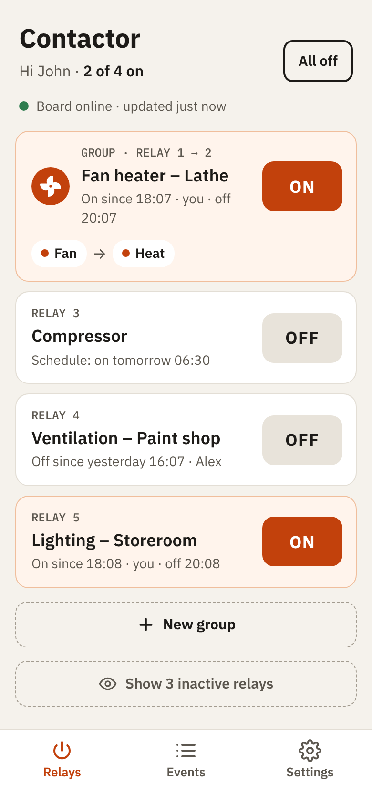
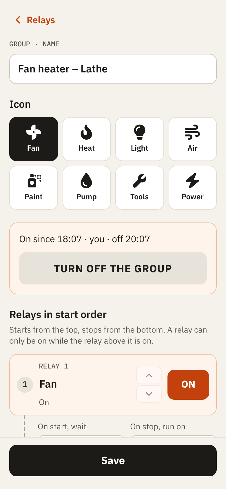
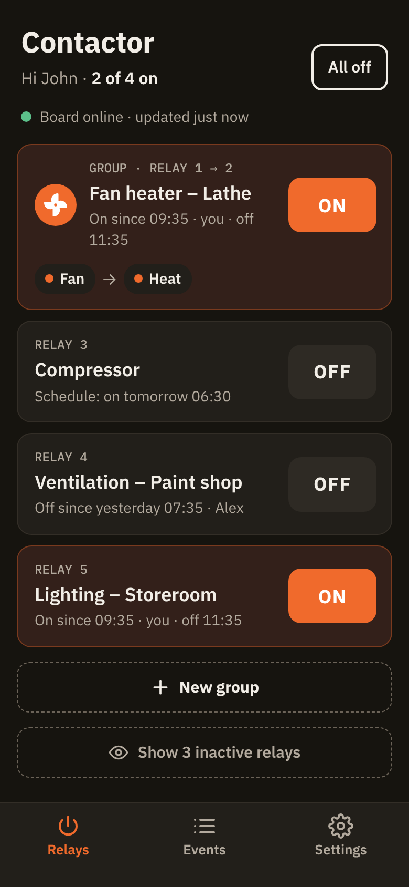
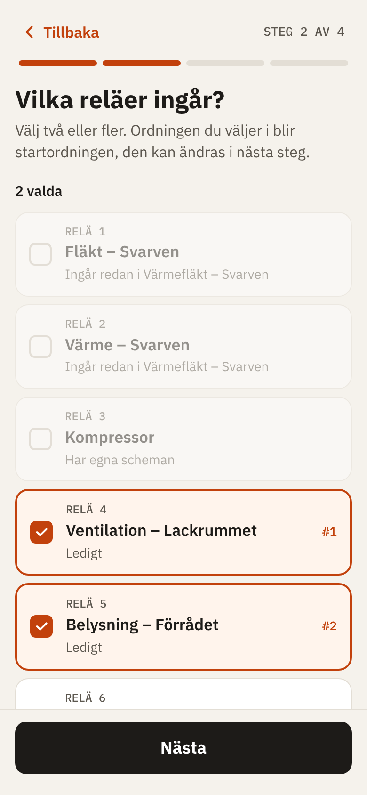
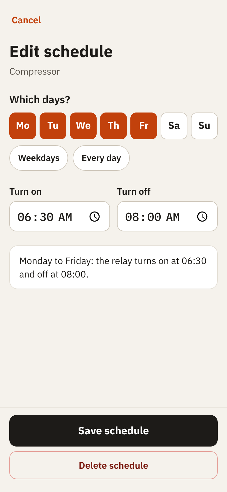
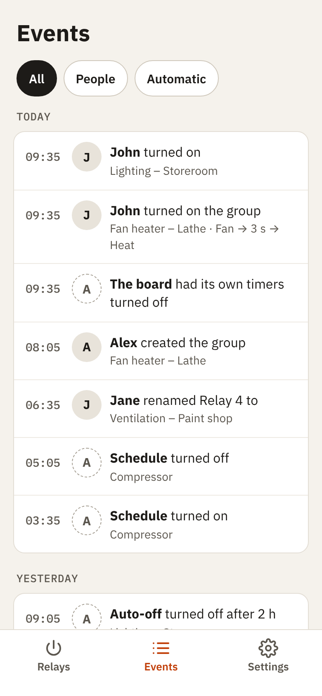
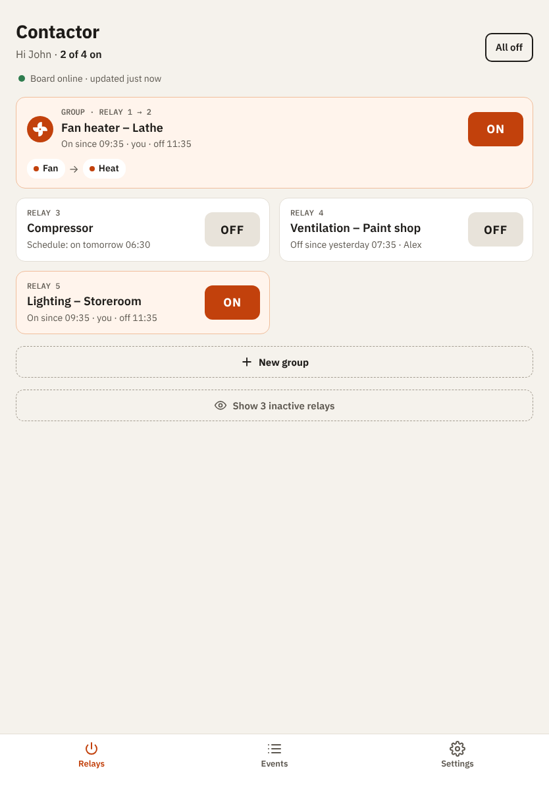
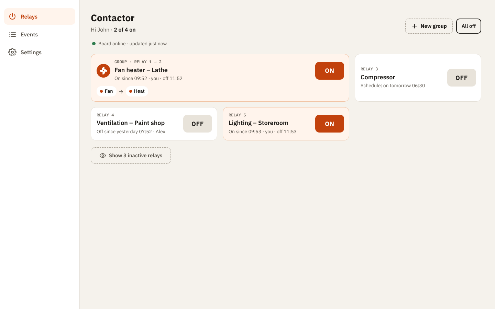

# Contactor

Control a relay board from your phone: turn things on and off, run them on schedules, and start several relays in
order as one group, e.g. a fan heater: the fan first, then the heat, and the fan running on after the heat goes off.
An interlock keeps the group in that order whatever happens, and every change is logged with who made it.

It is built for a workshop and for people who aren't technical: big buttons, few menus, and a page that works like an
app on the phone and uses the whole screen on a tablet or a computer, in light and dark mode.

<p>
  
  
  
</p>

## What it does

- **Setup guide:** a new installation starts with a few short questions: your name, which relay board, where it is
  on the network, and what each relay switches, with "Try" to hear which one it is.
- **Relays:** one big on/off button per relay, with who turned it on and when it goes off. "All off" turns
  everything off.
- **Auto-off:** a relay someone turns on goes off by itself after 1, 2 or 4 hours, unless set to never.
- **Schedules:** on and off at set times on chosen days, also over midnight and across daylight saving changes.
- **Groups:** two or more relays that start from the top and stop from the bottom, with a wait between steps and a
  run-on time, created with a short guide.
- **Interlock:** a relay in a group may only be on while the ones above it are; if something breaks the order, e.g.
  someone presses a button on the board itself, the app turns the relays below off at once.
- **Event log:** every change, by a person, a schedule, auto-off or at the board itself.
- **Backups:** a copy of the database every night, and a download button.

<p>
  
  
  
</p>

On a tablet the cards sit in two columns; on a computer a side menu replaces the tab bar:

<p>
  
  
</p>

The interlock in the app is an extra layer, not a safety device: it only works while the app runs. Where safety
depends on it, e.g. heat without the fan, wire it in the installation as well. Electrical work must be done by a
qualified electrician.

## Supported boards

| Board | Relays | Status |
|---|---|---|
| Velleman VM201 (WMRC201), ethernet | 8, plus 1 input | Supported |
| Velleman VM204 (WMRC204), ethernet | 4, plus 4 inputs and 1 analog input | In the app and the simulator; not yet tested on a real board, and `deploy/` sets up a VM201 only |
| Velleman VM208, ethernet or WLAN | 4, plus 1 input | In the app and the simulator; not yet tested on a real board, and `deploy/` sets up a VM201 only |
| Waveshare Modbus PoE ETH Relay, (B), (C), 16CH and 30CH | 8, 8 plus 8 inputs, 8 plus 8 inputs, 16, 30 | In the app and the simulator; not yet tested on a real board, and `deploy/` sets up a VM201 only. See [its README](Contactor.Boards.Waveshare/README.md) |
| Devantech ETH002-B, ETH008-B, ETH484-B and ETH8020-B | 2, 8, 4 plus 8 inputs, 20 plus 8 inputs | In the app and the simulator; not yet tested on a real board, and `deploy/` sets up a VM201 only. See [its README](Contactor.Boards.Devantech/README.md) |

The app talks to a board through one interface, `IRelayBoard`, so another board needs its own small project and
nothing else. One board per installation for now; several at once is
[issue #4](https://github.com/gonace/Contactor/issues/4).

## How it runs

- On a Raspberry Pi (or any Linux machine with Docker) next to the board, with Docker Compose.
- Sign-in is done by Cloudflare Access, with a one-time code by e-mail; no port is opened to the internet.
- .NET 10, Blazor Server and SQLite. No JavaScript framework.

See [docs/DEPLOY.md](docs/DEPLOY.md) to set it up. A single Docker image that installs in a click is
[issue #3](https://github.com/gonace/Contactor/issues/3).

## Development

Needs the .NET 10 SDK.

```sh
dotnet build Contactor.slnx
dotnet test --solution Contactor.slnx
```

Run everything locally with Aspire (the dashboard opens on http://localhost:15280):

```sh
dotnet run --project Contactor.AppHost
```

The AppHost starts a VM201 simulator on port 9760 and the app against it, signed in as `john@example.com`. The
simulator's page, linked from the dashboard, shows the board's relays and every packet, and switches relays as the
board's own buttons would. Stop and start the simulator in the dashboard to test a lost connection to the board. The
tests use the same simulator, so no hardware is needed.

`docs/ARCHITECTURE.md` describes the architecture and the rules the app follows, and `AGENTS.md` how to work in this repository. Each board's protocol or routes are in the `README.md` of its project, e.g. `Contactor.Boards.Vm201/README.md`.

### Screenshots

The pictures above are taken by a script, with made-up data: it starts the simulator and the app on a temporary
database, fills it, and photographs the screens at phone size. It needs Node 22 or later and Playwright with
Chromium.

```sh
node scripts/screenshots/take.mjs
```

## Licence

Contactor is released under the MIT License, see `LICENSE`. It also includes others' work under their own licences:
the fonts, the group icons, the packages it uses and, in the image, `cloudflared`. `THIRD-PARTY-NOTICES.md` lists them.
